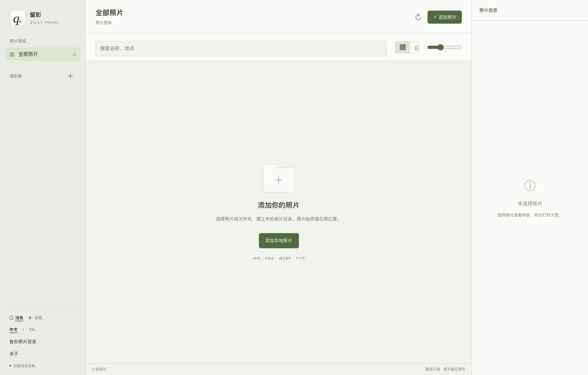

# Quiet Frame · 留影

A **local desktop photo manager that references original paths**. Native window and system file pickers. No browser launch, original-file duplication, or cloud uploads.

English · [中文](README.md)



## Launch

The macOS Apple Silicon package includes the runtime and needs no Python installation. Running from source requires Python 3.9+ and internet access for initial dependencies.

- **macOS:** download `quiet-frame-macos-arm64.zip` from Releases, extract and double-click `留影.app`. You can move it to Applications. To run from source, use `启动留影.command`. The local app is not Apple-notarized; macOS may require approval in Privacy & Security.
- **Windows:** install Python with Python Launcher, then run `start.bat`. Requires WebView2.
- **Linux:** run `sh start.sh` with GTK/Qt support. For Qt, install `PyQt5 PyQtWebEngine qtpy` in the virtual environment.

The macOS native window has been tested. Windows/Linux scripts have not been tested on their respective systems. Closing the window stops the internal service. A second macOS launch focuses the existing window.

## Workflow

Choose Add photographs or press Cmd/Ctrl+O. Select files or a folder, optionally including subfolders. Absolute file paths can also be pasted manually, one per line. Adding from All photographs creates a collection; adding while a collection is selected uses that collection.

Single-click for the inspector, double-click or Enter for the viewer. Edit metadata, set covers, reveal originals in their folder, relink files, or remove catalog records. Persistent Chinese/English and light/dark themes are included. Adjustable thumbnail grid/list, without a website landing page or bundled sample photographs.

JPEG, PNG, WebP and TIFF are supported. Export HEIC/RAW as JPEG first. EXIF includes camera, lens, focal length, aperture, shutter, ISO, date and GPS. Missing fields stay blank. GPS is editable coordinates without online geocoding; timestamps are shown as recorded.

## Referenced files

The app stores absolute source paths, collection information, editable metadata and JPEG previews (long edge up to 2400 pixels). It never copies new originals or writes metadata into them. Duplicate paths within the same collection are skipped.

Moved/renamed files or disconnected drives appear offline; cached previews remain viewable. Relink to a new location without losing edited metadata. Refresh checks source availability; there is no continuous watcher or automatic discovery.

**Removing a photograph or collection only removes records and preview caches. Source files are never deleted.**

Old copy-based records are automatically migrated to paths pointing at the existing `data/originals/` copies. Those copies are retained. Relink to your true originals if desired; the app never guesses or deletes old copies.

## Backup

The packaged macOS app stores data in `~/Library/Application Support/Quiet Frame/`. The source version uses the project’s `data/` directory, ignored by Git. `archive.sqlite3` stores records and paths; `previews/` stores caches; `window-state/` stores preferences. The two versions use separate directories: close both apps before copying an existing catalog between them. Old databases are migrated on startup.

Back up catalog opens a native save dialog and exports SQL, paths and previews, **not originals**. Back up originals separately. Alternatively, close the app and copy `data/`.

Restore a trusted ZIP into a new `restored/` folder, then run:

```sh
python3 -c "import sqlite3,pathlib; p=pathlib.Path('restored'); c=sqlite3.connect(p/'archive.sqlite3'); c.executescript((p/'archive.sql').read_text(encoding='utf-8')); c.close()"
```

With the app closed, preserve the existing `data/` and replace it with `restored/`. Originals must remain at their original paths or be relinked.

## Development

```sh
python3 -m venv .venv
source .venv/bin/activate
pip install -r requirements-desktop.txt
python desktop.py
python -m unittest discover -s tests -v
```

pywebview provides the desktop shell and dialogs. Flask, SQLite and Pillow power the local catalog; HTML/CSS/JS are embedded UI. The internal API listens on loopback, validates Host and protects writes with a token. No website deployment or multi-user features.

`QUIET_FRAME_DATA` sets the data directory. `PORT` changes the internal port (default 47321). `python app.py` is only a developer UI preview. Native dialogs require the desktop app.

## Build the macOS application

```sh
pip install -r requirements-build.txt
sh build-macos.sh
```

The output is `dist/留影.app`, including Python and dependencies, without personal data. The provided binary targets Apple Silicon.

## License

MIT. Do not commit private catalog data, photographs or screenshots containing private source paths.
