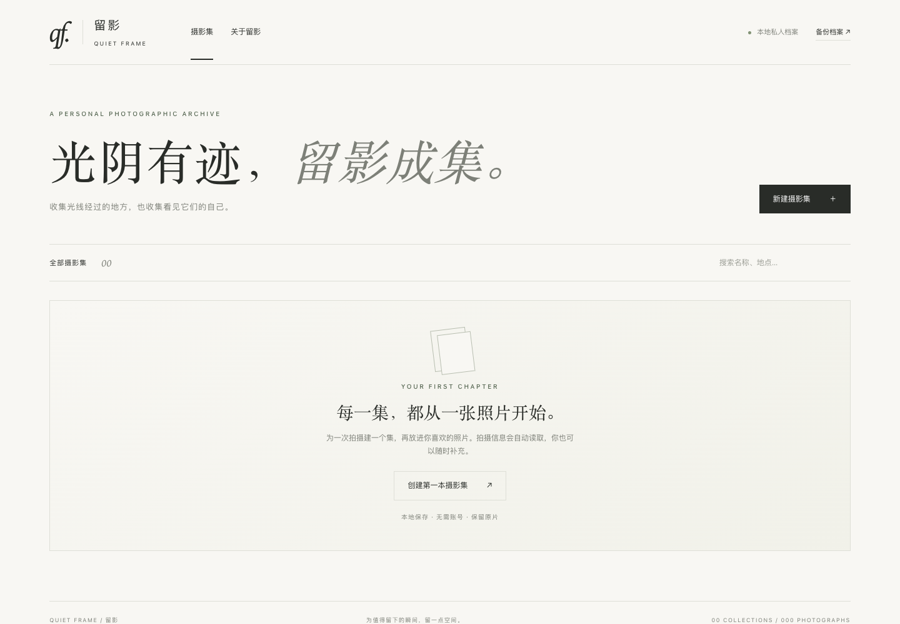
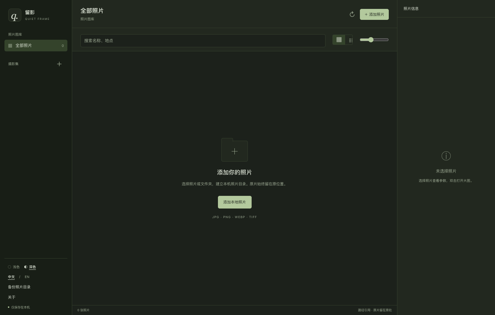

# Quiet Frame · 留影

一个安静、私密的本地摄影档案。按每次拍摄整理摄影集，保留原片、地点与拍摄参数。

[English](README.en.md) · 中文

浅色模式



深色模式



## 开始使用

需要 **Python 3.9+**。首次安装依赖需要网络，之后可离线使用，无需 Node.js 或在线账号。

- **macOS**：双击 `启动留影.command`，自动打开浏览器。若系统阻止运行，可在终端进入项目目录后执行 `bash 启动留影.command`。
- **Windows**：安装 Python（包含 Python Launcher），双击 `start.bat`。
- **Linux / 终端**：执行 `sh start.sh`。

浏览器地址：<http://127.0.0.1:47321>。关闭网页不会停止服务；在启动终端按 `Ctrl+C` 停止。macOS 再次双击会打开已运行的实例。

## 使用流程

1. 新建摄影集，填写名称、地点、日期与介绍。
2. 导入或拖入照片，支持一次多张（每批总量最多 512 MB）。
3. 点击照片打开大图，查看或编辑拍摄信息；方向键切换照片，Esc 关闭。
4. 可将任意照片设为封面，搜索摄影集，下载原片或删除本地档案副本。
5. 点击左下角「备份档案」，下载含原片、预览图与数据库 SQL 的 ZIP。

### 文件与拍摄信息

支持 **JPEG、PNG、WebP、TIFF**。HEIC、RAW 请先导出为 JPEG。带透明度的照片会生成白底预览，原片保持原样；预览最长边 2400 像素，按照 EXIF 方向校正。

导入时尝试读取：相机、镜头、焦距、光圈、快门、ISO、拍摄时间、GPS 经纬度。GPS 默认显示为坐标，可改成地名。应用不调用在线地理编码，不向第三方发送照片或坐标。没有 EXIF 的字段保持空白，可人工填写；编辑信息仅修改数据库，不会写入原片。拍摄时间按相机记录的当地时间显示，不推断时区。

## 数据与备份

默认保存在项目下的 `data/`：

```text
data/
  archive.sqlite3   # 摄影集、照片信息
  originals/        # 导入的原片副本
  previews/         # 生成的 JPEG 预览
```

照片和数据库均被 Git 忽略，不会提交到公开仓库。所有字体使用本机系统字体，没有远程字体、追踪或第三方前端脚本。

**最简单的完整备份**：停止服务后复制整个 `data/` 文件夹。恢复时停止服务，再把备份目录放回原处。

**从 ZIP 备份恢复**：停止服务，将 ZIP 解压到一个新目录（例如 `restored/`），然后运行：

```sh
python3 -c "import sqlite3,pathlib; p=pathlib.Path('restored'); c=sqlite3.connect(p/'archive.sqlite3'); c.executescript((p/'archive.sql').read_text(encoding='utf-8')); c.close()"
```

将现有 `data/` 改名保留后，再把 `restored/` 改名为 `data/`。只恢复来自自己或信任来源的备份。为保证文件与数据库完全对应，请在导入、删除结束后再导出备份。大档案导出 ZIP 会占用额外内存；建议停止服务后直接复制 `data/`。

## 设计与语言

以照片为主体的作品集布局：左侧系列目录、大幅封面、画廊 / 索引切换；摄影集内支持组照 / 逐张浏览。大图使用暗色观看区，参数放在独立侧栏。窄屏时导航与主题开关移到顶部。

- **中文 / English**：切换导航、表单、参数、提示、错误和删除确认，选择保存在本机。你输入的摄影集名称、地点和笔记保留原文。
- **浅色 / 深色**：首次跟随系统，也可手动选择；选择会保留到下次打开。照片不应用主题滤镜。
- 字体使用本机 Georgia / 宋体与 Helvetica / 苹方，不请求外部字体。
- 首次使用展示一张明确标注的 Unsplash 示例图片；导入作品后由你的摄影集替代。示例不会写入数据库或冒充个人照片，拍摄参数也不会伪造。

布局参考：[川内伦子](https://rinkokawauchi.com/works/)的系列导航、[Reuben Wu](https://reubenwu.com/)的图像布局、[Alan Schaller](https://www.alanschaller.com/)的大图观看，以及 [Alec Soth](https://alecsoth.com/photography/)的项目组织。未复制这些摄影师的照片。

示例图片遵循 Unsplash License，详见 [第三方素材说明](THIRD_PARTY_NOTICES.md)。

## 本地开发

```sh
python3 -m venv .venv
source .venv/bin/activate  # Windows: .venv\Scripts\activate
pip install -r requirements.txt
python app.py
python -m unittest discover -s tests -v
```

可用 `PORT=47322 python app.py --no-browser` 修改端口或关闭自动打开。`QUIET_FRAME_DATA=/absolute/path` 可指定独立数据目录。服务只监听本机回环地址；写入请求使用会话令牌，并校验 Host。应用面向个人电脑的本地使用，未提供多用户登录或公网部署配置。

技术栈：Python / Flask / SQLite / Pillow / 原生 HTML、CSS、JavaScript。无前端构建步骤。

测试覆盖 EXIF/GPS 读取、无 EXIF 图片、导入/编辑/删除、重启持久化、备份还原、无效文件与本地写入保护。macOS 浏览器流程另验证了新建集、上传、编辑、重载、手机排版、删除、中英文切换、草稿保留、画廊/索引/逐张浏览与主题持久化；Windows/Linux 启动脚本未在对应系统实测。

## 开源

MIT License。欢迎提交 Issue 和 Pull Request。请勿在 Issue 或提交中附带未经检查的个人照片、GPS 或本机数据目录。
